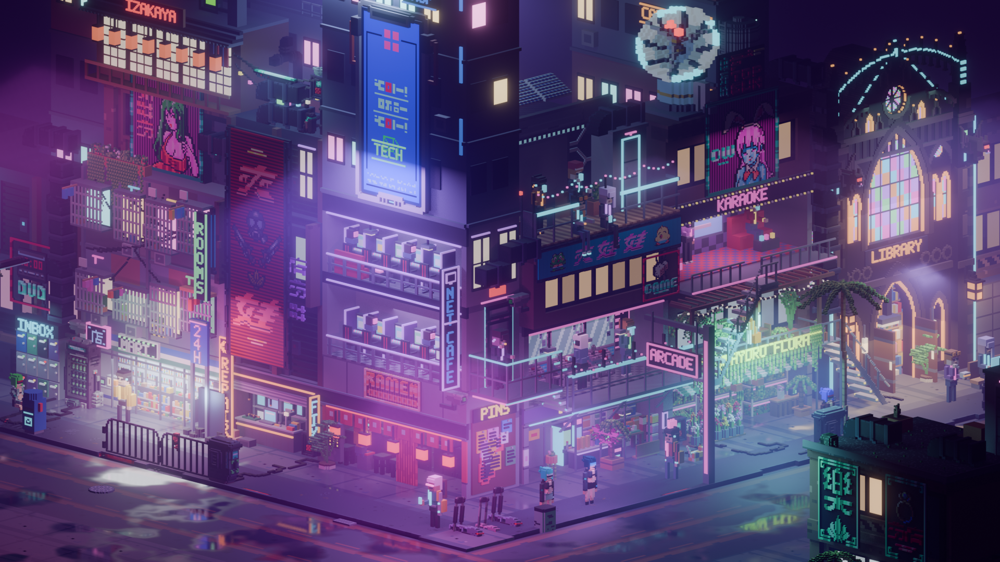
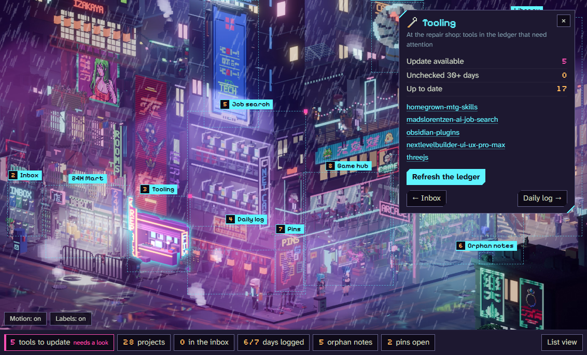
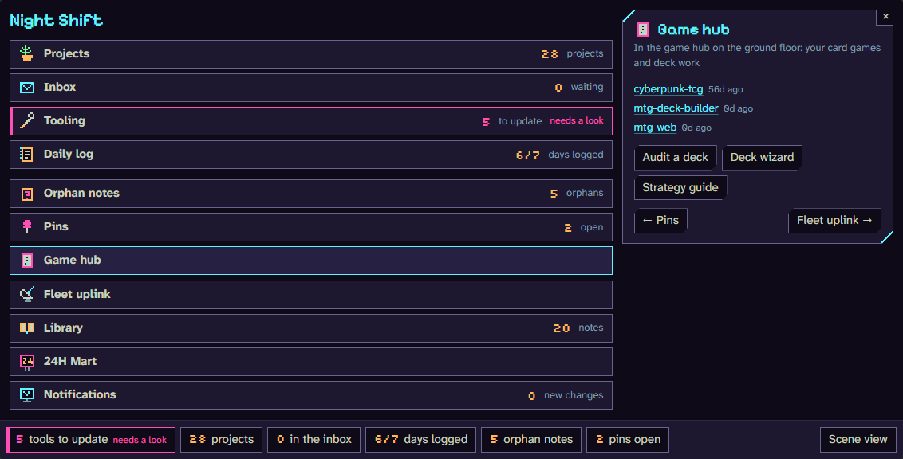

# Night Shift Command Center

[](https://github.com/drandee-dev/night-shift-command-center/actions/workflows/ci.yml)

A clickable 3D street corner that works as the home screen of my notes vault. Each shop, sign and prop in the scene is
a button. Clicking one opens a panel with live numbers from the vault, and the buttons in that panel start real work:
a check that runs on my PC, or a new Claude Code session in VS Code with the right prompt already typed in.



**Status: work in progress.** I am still building this across several sessions, so the repo is a snapshot that I
refresh as the project moves. The Blender scripts that build the scene will be added in a later snapshot.

## What it does

The scene is a voxel cyberpunk corner rendered in Blender. Every object I can click has its own hover mask, so it
lights up on its own outline rather than as a box. The panels map to parts of my setup:

- the florist holds my projects, with a Resume button per repo
- the repair shop shows tools in my tooling ledger that are out of date
- the ramen stand is today's log and the weekly review
- the net café counts job search follow-ups, and once a day a small note in the corner names the ones that have just
  come due (the names come from my private tracker, never from this repo)
- the 24H Mart shows this PC's scheduled tasks, with their logs one click away
- the satellite dish shows the status of a small fleet of Discord agents I run on a cloud server, pulled every 10
  minutes while I am logged on
- a trash bag on a rooftop counts notes that nothing links to, and more bags pile up on the roof as that count grows
- the library takes a typed topic and starts a research session, and its "dusty shelf" lists skills I have not used
  in 30 days
- a flyer wall holds things I asked a session to pin, each with resume, stress-test and scope actions

While something runs, its object pulses cyan. A failure turns it pink, and a finished check flashes green.



The same panels work without the picture. The list view shows every panel with its count, and the panel opens
beside it:



## How a click becomes work

```
Obsidian note (Dataview JS)  --POST /actions/<id> + X-Night-Shift header-->  local server on 127.0.0.1:8790
                                                                                  |
                                     a fixed allowlist of actions (actions.py), each one fixed argv, no shell
                                                                                  |
                              "check": runs on this PC            "session": opens VS Code with the prompt filled in
```

The dashboard is a single Dataview JS block in `night-shift-dashboard.md`. It draws the scene, the panels and the
count strip, and polls the server every 5 seconds while the scene is on screen. The server is FastAPI
(`_dashboard/night_shift_server.py`, routes in `_dashboard/nightshift_api.py`). A session button never sends the
prompt on its own: VS Code opens with it ready and I press Enter.

## Security

The server has no login, so the design makes sure nothing but my own clicks can reach it.

- It binds to 127.0.0.1 only and refuses any other address.
- Every route checks the Host header, which blocks DNS rebinding.
- Every route needs a token. The server makes a new random one at each start and writes it to a file in my profile that
  only my Windows account can read (inherited access is removed), and the dashboard note reads that file for each
  request. Other accounts and sandboxed programs on the PC cannot read it, so they cannot call the server. A program
  running as my own account still could, which is the usual limit of a local token.
- The token travels in a custom header. A web page in a browser would have to send a CORS preflight for that, and the
  server never answers one, so no website I visit can call it.
- A click sends only an action id from a fixed list. Each action is a fixed command run without a shell.
- The one place I can type text, the library box, accepts at most 150 printable characters, caps the encoded length,
  and wraps the text in `<user_input>` tags with an instruction to treat it as data. A few actions accept only an exact
  name from a list.
- The fleet status pull is one read-only ssh command that fails instead of prompting. The server address and key
  path come from settings outside the code, and the host must look like `user@host` so it can never become an ssh
  option.
- Logs can only be read for names on a list.

## Accessibility

- Every button has a short tooltip after one second. It stays while the pointer is on it and Escape closes it
  (WCAG 1.4.13).
- Buttons, the text box and the close button have borders at 3:1 contrast or more against the panel (WCAG 1.4.11).
- Trouble is shown by more than colour: counts that need a look get a pink edge and the words "needs a look"
  (WCAG 1.4.1).
- Small objects get a click area of at least 24 by 24 pixels (WCAG 2.5.8).
- Number keys open panels, arrow keys step between them, Escape closes and returns focus to the object that opened
  the panel, and holding Alt shows every label.
- A list view replaces the picture with a plain list of every panel. It turns on by itself if the picture fails to
  load.
- Motion starts off when the system asks for reduced motion.

## Repository layout

The repo keeps the folder layout of my vault, so the note works when dropped into a vault and each snapshot is a
straight copy of the live code.

```
night-shift-dashboard.md        the dashboard: one Dataview JS block (scene, panels, polling, keyboard, list view)
_attachments/scenes/            the rendered scene, one hover mask per object, the rain loop, the hotspot boxes and
                                the three trash-pile layers
_dashboard/
  night_shift_server.py         the server on its own (loopback only)
  nightshift_api.py             the routes and their guard
  actions.py                    the allowlist of actions and the runner that validates and starts them
  nightshift.py                 live state: run states, schedules, fleet status, unused skills, log tails
  open_session.py               opens VS Code on a folder with a prompt ready
  fleet_pull.py, fleet_probe.py the read-only status pull from the fleet server
  usage.py, vault.py            readers for Claude Code transcripts and the vault
  tests/                        unittest suite, run in CI on Windows
```

Adding a button is one entry in the action table in `actions.py` and one tooltip line in the note. Adding a clickable
object is one entry in the note's panel list, keyed by the tag the object carries in the scene.

The server is not containerized on purpose. Its job is to act on this PC: open VS Code, read Windows Task Scheduler,
read the vault and the Claude Code transcripts. A container would cut it off from exactly those. The fleet of Discord
agents it reports on runs in Docker on a cloud server.

## Running it

This is built around my own vault, so it is more useful to read than to run as is. To try the server:

```
pip install -r requirements.txt
python _dashboard/night_shift_server.py
python -m unittest discover -s _dashboard/tests
```

The note needs Obsidian with the Dataview plugin and JavaScript queries turned on. It loads its two fonts from
Google Fonts.

Some parts are Windows-only: session buttons open VS Code through `code.cmd` and the Windows URL handler, and the
24H Mart reads Windows Task Scheduler. Comments in the code sometimes point to planning notes in my private vault;
those notes are not part of this repo. The scene's motion loop is not in this snapshot yet, so the still image shows
instead.

## How this was built

Claude Code did most of the implementation. I set the direction for every part: which objects become which panels,
what each button may and may not do, and the order of the work. For visual and interaction changes I chose between
rendered options before anything was built. Each change was then checked by a separate review agent that runs the
tests and reports what is broken before it goes live, and I am accountable for everything here.

## Credits and licence

The scene is built with Max Parata's voxel cyberpunk asset packs ([itch.io](https://maxparata.itch.io/)). The packs
are not in this repo and are not covered by its licence; the renders are shown with credit, which the author allows.

The code is MIT licensed, see `LICENSE`.
